[English](./README.en.md) · [Website](https://skillsig.lei6393.com) · [GitHub](https://github.com/SuperMarioYL/skillsig)

<picture>
  <source media="(max-width: 600px) and (prefers-color-scheme: dark)" srcset="./assets/presentation/hero-mobile-dark.svg">
  <source media="(max-width: 600px)" srcset="./assets/presentation/hero-mobile-light.svg">
  <source media="(prefers-color-scheme: dark)" srcset="./assets/presentation/hero-dark.svg">
  
</picture>

# skillsig

**在信任更新前检查 Skill 权限。**

skillsig 比较 Skill 声明范围、frontmatter 授权与已保存基线，再检查签名 bundle。

## 为什么需要它

Skill 更新可能扩大允许工具，而安装它的任务并未改变。经过检查的 manifest 与基线使权限扩张在验证时可见。

- **比较声明授权** — 工具模式与 manifest 范围进行比较。
- **发现基线扩张** — 已保存检查范围可揭示后续扩张。
- **接入 CI 输出** — JSON、SARIF 与退出码可接入自动化。

## 架构

<picture>
  <source media="(max-width: 600px) and (prefers-color-scheme: dark)" srcset="./assets/presentation/architecture-mobile-dark.svg">
  <source media="(max-width: 600px)" srcset="./assets/presentation/architecture-mobile-light.svg">
  <source media="(prefers-color-scheme: dark)" srcset="./assets/presentation/architecture-dark.svg">
  
</picture>

Manifest 解析器读取 SKILL.md 与 SKILLSIG.yaml；范围扫描器比较授权与既有锁记录。签名校验共同决定 TRUSTED、UNSIGNED、SCOPE-DRIFTED 或 MALFORMED，再渲染为表格、JSON 或 SARIF。

| 组件 | 职责 |
| --- | --- |
| `Skill manifest` | internal/manifest |
| `Scope scanner` | internal/scope |
| `Signature verifier` | internal/verifier |
| `Table / JSON / SARIF` | internal/report |

## 安装与快速上手

使用仓库清单指定的运行时版本构建，并在仓库根目录运行示例。

```bash
git clone https://github.com/SuperMarioYL/skillsig.git
cd skillsig
go build ./cmd/skillsig
```

使用空的独立基线路径验证随仓 Skill fixture 目录。

```bash
SKILLSIG_HOME=./examples/demo-empty-home go run ./cmd/skillsig verify ./testdata/skills/ --no-color
```

## 实际运行示例

<picture>
  <source media="(max-width: 600px) and (prefers-color-scheme: dark)" srcset="./assets/presentation/process-mobile-dark.svg">
  <source media="(max-width: 600px)" srcset="./assets/presentation/process-mobile-light.svg">
  <source media="(prefers-color-scheme: dark)" srcset="./assets/presentation/process-dark.svg">
  
</picture>

The recorded report exposes the fixture scope mismatch and missing signature state without executing skill content.

```text
SKILL                              VERDICT        DETAILS
---------------------------------  -------------  -----------------------------------------------
skillsig-examples/jqwik-style-bad  SCOPE-DRIFTED  undeclared grant(s): Bash(rm -rf ~/.claude/*)
skillsig-examples/safe-skill       UNSIGNED       no valid signature bundle (unsigned)
scope-mismatch                     UNSIGNED       no skillsig manifest (sidecar or SKILLSIG.yaml)
3 skill(s): 0 trusted, 2 unsigned, 1 scope-drifted, 0 malformed
```

完整命令与输出保存在 [docs/demo-results.json](./docs/demo-results.json). 输入和复现代码均随仓提供。


保留已有录制供参考；上方文字示例给出当前可复现的操作。

## 用法

CLI 提供以下操作。示例之外的命令需要替换成你的文件路径或标识。

```bash
go run ./cmd/skillsig verify ./testdata/skills/ --no-color
go run ./cmd/skillsig verify ./testdata/skills/ --json
# CI rejects unsigned, drifted or unreadable rows:
skillsig verify ./skills --ci --sarif results.sarif
```

## 配置

SKILLSIG_HOME 可更改本地锁存储位置。普通 verify 只读；--trust 只记录当前受信任范围。--force-trust 配合 --trust 显式重置漂移基线，应先检查权限变化。--json 与 --sarif 输出结构化报告。

## 集成与职责分工

<picture>
  <source media="(max-width: 600px) and (prefers-color-scheme: dark)" srcset="./assets/presentation/integrations-mobile-dark.svg">
  <source media="(max-width: 600px)" srcset="./assets/presentation/integrations-mobile-light.svg">
  <source media="(prefers-color-scheme: dark)" srcset="./assets/presentation/integrations-dark.svg">
  
</picture>

以下路径已有源码实现。按任务选择输入，并把生成的结果与项目一起保存。

| 路径 | 已实现职责 |
| --- | --- |
| SKILL.md | Declared allowed-tools grants |
| SKILLSIG.yaml | Intent and attestation metadata |
| Ed25519 bundle | Local signature verification |
| Lock baseline | Cross-version scope comparison |
| SARIF | Code-scanning report artifact |

## 限制与后续方向

- 当前构建未接通 Sigstore keyless 后端；--dev 使用临时 Ed25519 密钥。
- Manifest 范围检查不执行运行时文件系统或网络隔离；签名也不证明行为安全。
- 示例只检查随仓合成 Skill，不写入信任基线。

真正的 keyless 签名后端与更强身份策略需要后续实现；当前产物是本地范围与签名验证器。

## 许可与贡献

许可见 [LICENSE](./LICENSE). 反馈问题时请提供最小输入、执行命令和实际输出。
